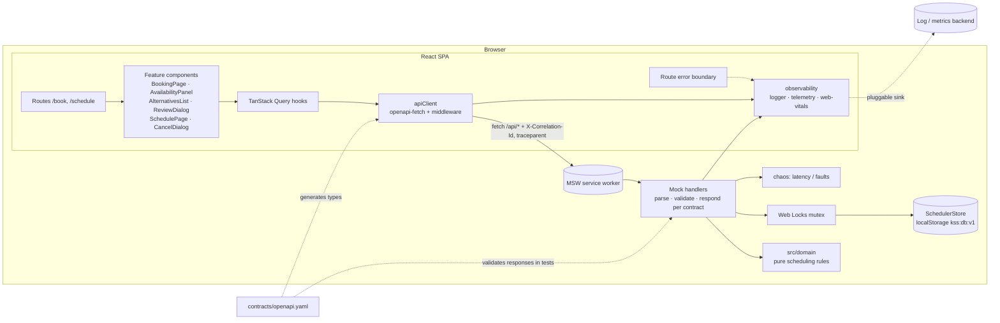
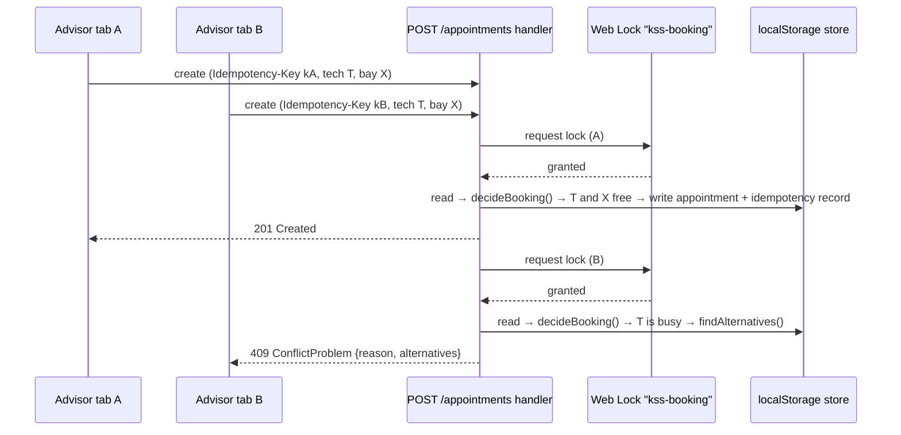

# System Design: Unified Service Scheduler

Design of the service-appointment scheduler for dealership service advisors (Keyloop assessment,
Scenario A). The requirements are in [spec.md](../specs/001-service-scheduler/spec.md). The
decisions behind this design, with the alternatives that were rejected, are in
[research.md](../specs/001-service-scheduler/research.md).

## 1. Scope

This version builds the **frontend**: a single-page app for advisors. The backend runs as a mock
inside the browser. It intercepts requests at the network layer and must honour the published API
contract ([contracts/openapi.yaml](../contracts/openapi.yaml)). Because the UI only ever talks to
that contract, a real backend can replace the mock without changing the UI. The scheduling rules
in `src/domain` are written so that they can be moved into that backend unchanged.

The three core requirements of the scenario map to the user stories in the spec:

| Assessment requirement | Where it is met |
|---|---|
| Resource-constrained booking for a vehicle, service type, dealership and desired time | US1: the booking form (`/book`) |
| Real-time check that a ServiceBay **and** a qualified Technician are both free for the whole service | US1 and US2: `checkAvailability` in the domain, called before confirmation and again inside the confirm request |
| A persistent Appointment record linking customer, vehicle, technician and bay | US1: `POST /appointments`, stored so it survives reloads |

Two more stories were added because a scheduler needs them in practice: safe concurrent booking
(US3) and viewing or cancelling a day's appointments (US4).

## 2. Assumptions

The brief leaves several things open. These are the assumptions this design makes, each with the
reason for it. The same list appears in the *Assumptions* section of the spec.

| # | Topic | Assumption | Why |
|---|---|---|---|
| A1 | Users | Users are dealership **service advisors**. There is no authentication or role management. | Not part of the brief. The contract declares `security: []` so that OAuth2/OIDC can be added later without changing any operation. |
| A2 | Reference data | Customers, vehicles, dealerships, bays, technicians and service types **already exist** (seeded synthetic data). The app does not create or edit them. | The brief is about booking, not master data. |
| A3 | Appointment shape | One appointment is **one service type, one technician and one bay** for one continuous window on one day. Work is never split across people, bays or days. | This is the simplest reading of "a ServiceBay and a qualified Technician". |
| A4 | Duration | Each service type has a fixed duration that is a multiple of 15 minutes. The window is `end = start + duration`. | The brief says "entire service duration" without defining it. |
| A5 | "Qualified" | A technician is qualified when they hold the **skill** the service requires **and** work on that weekday. | Skills make "qualified" testable. Working days cover part-time staff. |
| A6 | Bay compatibility | A bay is compatible when it is **active** and of the **bay type** the service requires (`GENERAL`, `EV`, `ALIGNMENT`). | Bays differ physically, for example EV lifts and alignment rigs. |
| A7 | Opening and working hours | Each dealership has fixed opening hours and open days. Technicians work the dealership's hours on their working days. Breaks, holidays and overtime are out of scope. | Keeps the rules small. This is listed as a limit in §12. |
| A8 | Time | Start times are on a **15-minute grid**, entered and shown in the **dealership's time zone**, and stored as UTC. | Advisors book in local time. Two seeded dealerships (`Europe/London`, `Asia/Ho_Chi_Minh`) exercise this. |
| A9 | Conflicts | Windows are **half-open** `[start, end)`. A booking that starts exactly when another ends is allowed; any overlap is not. Cancelled appointments never block. | This is the standard rule and avoids off-by-one disputes. |
| A10 | "Real-time" | Availability is checked against the **latest stored bookings** when the advisor asks, and **checked again when they confirm**. Other open screens are not updated live. | This gives the correctness guarantee without needing a push channel. |
| A11 | Choosing resources | When several technicians or bays qualify, the one with the **fewest confirmed bookings that day** is chosen. Ties go to the earlier name, then the earlier id. | The result is deterministic, so it can be tested, and it spreads the workload. |
| A12 | Unavailable slots | The app gives the reason and up to **5 nearest alternative start times within 7 days**, at the same dealership for the same service. | Customers rarely accept "no". The bound keeps the search cheap. |
| A13 | Stale confirmation | If the technician or bay the advisor reviewed has been taken, confirming returns **409 with fresh alternatives**. Resources are never reassigned silently. | The advisor always confirms exactly what they reviewed. |
| A14 | Persistence | Because only the frontend is built, "persistent" means the record **survives reloads and restarts in the browser** (localStorage). It is shared by tabs of the same browser, not across devices. | The brief allows a mocked backend. The contract defines what a real database-backed service must do. |
| A15 | Rescheduling | To reschedule, cancel the appointment and book again. Customer notifications (SMS or email) are out of scope. | YAGNI for this version. |

## 3. Architecture



### Components and the direction of imports

| Layer | Folder | Responsibility | May import |
|---|---|---|---|
| Domain | `src/domain` | Pure rules: overlap, opening hours, qualification, assignment, alternatives, booking decision | nothing app-specific (enforced by ESLint; `now` is a parameter) |
| Mock backend | `src/mocks` | HTTP handlers, persistence, lock, idempotency, chaos, seed | domain, observability |
| API client | `src/api` | Types generated from the contract, one client, query hooks, error mapping | observability |
| Features | `src/features` | Booking and schedule screens | api, components, lib (never `mocks`, enforced by ESLint) |
| Cross-cutting | `src/observability`, `src/components/ui`, `src/lib` | Logging and telemetry, accessible primitives, time-zone formatting | — |

## 4. Data model

These entities match [data-model.md](../specs/001-service-scheduler/data-model.md).

- **Dealership** has a time zone, opening hours and open days, and offers a set of service types.
- **ServiceType** has a duration, the technician skill it requires and the bay type it requires.
- **ServiceBay** belongs to one dealership and has a type and an active flag.
- **Technician** belongs to one dealership and has a set of skills and working days.
- **Customer** owns one or more **Vehicles**.
- **Appointment** links customer, vehicle, dealership, service type, technician and bay for a
  half-open window `[start, end)`. Its status is `CONFIRMED` or `CANCELLED`, and its reference has
  the form `APT-YYYYMMDD-XXXX`.

All instants are ISO-8601 UTC. Opening hours are local wall-clock times in the dealership's IANA
time zone.

## 5. API

The API is defined in OpenAPI 3.1 in [contracts/openapi.yaml](../contracts/openapi.yaml) and has
8 operations:

| Operation | Purpose | Notable responses |
|---|---|---|
| `GET /dealerships`, `GET /dealerships/{id}/service-types` | Reference data | 404 |
| `GET /customers?q=` | Search customers by name, phone or email, with their vehicles embedded | 400 when `q` is shorter than 2 characters |
| `POST /availability/check` | Read-only check. Returns the proposed technician and bay, or the reason it is unavailable plus up to 5 alternatives | always 200 for a valid request; 400, 404 |
| `POST /appointments` | Confirm a booking. Requires an `Idempotency-Key` header | 201 (or a replay of the original 201), 409 `ConflictProblem`, 422 |
| `GET /appointments?dealershipId&date` | List one dealership's day, ordered by start | 400, 404 |
| `GET /appointments/{id}`, `POST /appointments/{id}/cancel` | Read one appointment; cancel one (idempotent) | 404 |

Errors use RFC 9457 `application/problem+json` and carry a `correlationId`.

## 6. Key flows

### 6.1 Check availability

1. Once the form is complete and valid, the UI waits 300 ms for input to settle, then sends
   `POST /availability/check`.
2. The handler loads the dealership, the service type, its resources and their appointments, then
   calls `checkAvailability(ctx, start, now)`.
3. The domain checks the reasons in this order: service not offered → start in the past →
   dealership closed → outside opening hours → no qualified technician → no compatible bay.
4. If the slot is available, it chooses the technician and the bay with the fewest confirmed
   appointments that day. Ties are broken by name, then by id (A11).
5. If the slot is not available, `findAlternatives` scans a 15-minute grid from opening time on
   the requested day, up to 7 days ahead. It ranks the free slots by their distance from the
   requested start (earlier first on ties) and returns up to 5 (A12).
6. The result is rendered inside a `role="status"` live region, so screen readers announce it.

### 6.2 Confirm without double-booking



- **Lock.** The Web Locks API serialises the critical section across all tabs of the same origin.
  When it is unavailable (Node tests), an in-process promise queue is used instead.
- **Re-validation.** Inside the lock, the handler re-reads the store and checks the exact
  technician and bay that the advisor reviewed. It never reassigns them silently (A13).
  - If those resources are taken but the slot can still be served by others, the reason is
    `PROPOSED_RESOURCE_TAKEN` and the requested start is listed first among the alternatives.
- **Idempotency.**
  - The client generates one UUID key each time the review dialog opens. A retry after an error
    sends the same key.
  - The same key with the same body returns a replay of the original 201, with the header
    `Idempotent-Replayed: true`.
  - The same key with a different body returns 422.
- **In the UI**, a 409 shows "This slot was just taken" in a `role="alert"` region, along with
  fresh alternatives. Everything the advisor entered is kept.

### 6.3 Cancel

`POST /appointments/{id}/cancel` sets the status to `CANCELLED` and records `cancelledAt`.
Cancelling an appointment that is already cancelled returns it unchanged. Cancelled appointments
are ignored by every overlap check, so the slot becomes bookable at once. The schedule and
availability queries are refreshed after the cancellation.

## 7. Technology choices

The full rationale for each choice is in research R1–R17.

| Concern | Choice | Why |
|---|---|---|
| UI | React 19 + TypeScript (strict) + Vite 6 | Largest ecosystem for accessible components and testing; builds to a static site |
| Server state | TanStack Query 5 | Loading, error and retry states, caching and invalidation out of the box |
| API types | openapi-typescript + openapi-fetch | No hand-written API shapes; one place for request middleware |
| Mock backend | MSW 2 | Intercepts at the network layer; the same handlers run in the browser and in tests |
| Time zones | date-fns 4 + @date-fns/tz | Correct zoned arithmetic, including DST; formatting uses the dealership's zone |
| Forms | React Hook Form + Zod | Field-level errors linked with `aria-describedby` |
| UI primitives | Tailwind 4 + Radix Dialog / AlertDialog | Correct focus trapping and ARIA behaviour |
| Tests | Vitest, React Testing Library, Ajv, Playwright, axe | A test pyramid with business rules at the base |

## 8. Observability

| Signal | Implementation |
|---|---|
| Structured logs | `observability/logger.ts` writes `{ts, level, event, …}` to swappable sinks (console, in-memory, `sendBeacon`) |
| Tracing | Every request gets an `X-Correlation-Id` and a W3C `traceparent`. The mock echoes the id and logs with it. Error messages in the UI show the id as a "Reference" |
| Metrics | `api.latency_ms` for each request, counters for business events, and Web Vitals (LCP, INP, CLS) |
| Business events | `availability.checked`, `booking.confirmed`, `booking.conflict`, `booking.cancelled`, `api.error`, `ui.error` |
| Errors | A route-level error boundary with a *Try again* action, plus global `error` and `unhandledrejection` handlers |

To connect OpenTelemetry or Sentry later, add a sink with `addSink()`. Callers do not change.

## 9. Building for the future

This section shows how the design addresses the brief's five non-functional concerns: what this
version already does, and what a production version with a real backend would add.

### 9.1 Scalability

- **In this version:**
  - The UI is a static bundle and can be served from any CDN. It holds no per-user server state.
  - The scheduling rules have no I/O and no global state, so they can run on any number of
    stateless API instances once moved into a backend.
  - The cost of one availability check is bounded. The alternative search looks at no more than
    7–8 days × about 40 slots × the dealership's own resources, however large the overall data
    set grows.
- **In production:**
  - Partition data by dealership. Every query in the contract is scoped to one dealership, so the
    data shards cleanly.
  - Index appointments on `(dealership_id, resource_id, start)`.
  - Cache reference data (dealerships, service types), which rarely changes. The client already
    caches it for 5 minutes.
  - The contract does not need to change for any of this.

### 9.2 Performance

| Budget (plan.md) | Measured |
|---|---|
| Availability check plus alternatives < 20 ms | **About 4–6 ms** in the worst case: 10 technicians, 10 bays, a week fully booked, so the whole 7-day search runs. `src/domain/performance.test.ts` fails the build if this exceeds 20 ms. |
| Availability result shown < 1 s at p95 (SC-002) | Requests start 300 ms after input settles, plus 200–600 ms of simulated latency, plus a few ms of computation. The query cache removes duplicate checks for the same slot. |
| First-load JavaScript < 250 kB gzip | **The app: about 195 kB gzip.** In demo mode only, the mock backend (MSW and the store) loads as a separate chunk of about 105 kB gzip. With a real backend (`VITE_ENABLE_MOCKS=false`) that chunk is never requested. |

The first version of the alternative search took about 30 ms in that worst case and broke the
budget. The new performance test caught it. The fix indexes the appointments once per search
instead of re-parsing every appointment for every candidate slot, and it changed no behaviour.

### 9.3 Reliability

- **No double-booking.** The lock, the re-check inside the lock and the 409 response all guard
  this, and tests cover it at three levels: domain, handler (parallel requests) and end-to-end
  (two browser tabs).
- **Safe retries.**
  - Confirming requires an `Idempotency-Key`, so a double click, a timeout or a Retry can never
    create two appointments.
  - Reads retry once automatically. Writes never retry on their own; only the user retries, using
    the same key.
- **Graceful failure.**
  - Every data view has loading, empty and error states, and *Retry* keeps what the advisor
    entered.
  - A route-level error boundary contains crashes.
  - The mock's chaos settings (latency, failure rate, fail-next) are used both in tests and in
    demos to exercise these paths.
- **Data.** The stored data carries a schema version. If it is missing, corrupt or of another
  version, it is re-seeded automatically. *Reset demo data* re-seeds on demand.
- **In production:** replace the Web Lock with a database transaction plus a PostgreSQL exclusion
  constraint. One per resource:

  ```sql
  EXCLUDE USING gist (technician_id WITH =, tstzrange(start, "end", '[)') WITH &&)
    WHERE (status = 'CONFIRMED')
  ```

  The database then makes double-booking impossible even if application code is wrong.
  Idempotency keys would move to a table with a unique constraint and a time-to-live.

### 9.4 Maintainability

- **Contract-first.** API types are generated from `contracts/openapi.yaml`. CI fails if the
  generated types drift from the contract, and contract tests validate every handler response
  against the schema with Ajv.
- **Enforced layering.** ESLint stops the domain from importing React, the network, storage or
  `Date.now()`, and stops UI features from importing the mock backend.
- **Tests as the safety net.**
  - 85 domain tests, at 100% line and over 99% branch coverage, with a 90% gate in CI.
  - 31 contract tests, 3 mock-infrastructure tests, 17 component tests and 6 end-to-end tests.
  - Test names refer to the requirement they cover (FR-xxx or US-x) where one applies.
- **Traceability.** Spec, plan, research decisions, data model and tasks are kept in
  `specs/001-service-scheduler/`. The constitution (`.specify/memory/constitution.md`) records the
  rules every change must follow.
- **Small surface.** There are only two routes and no global store, and each dependency is
  justified in research.md.

### 9.5 Observability

See §8. Correlation ids run from the UI through the request headers to the mock's logs, so an
error message the advisor sees can be traced to the exact request.

## 10. Quality gates

The CI workflow ([.github/workflows/ci.yml](../.github/workflows/ci.yml)) runs these steps in
order: lint → type-check → contract lint → contract drift check → tests with a coverage gate
(`src/domain` must stay at or above 90%) → build → Playwright end-to-end and axe accessibility
tests.

## 11. How GenAI was used in the design phase

### Tooling and workflow

- **Agent:** Claude Code, working through the **GitHub Spec-Kit** commands.
- **Order of work:** each stage produced a file that was reviewed before the next stage began:
  constitution → spec → plan → tasks → implement.
- **Rule:** no code was written until the spec, plan and tasks existed.

| Stage | What the AI produced | What it was asked to do, and how the output was checked |
|---|---|---|
| Constitution | `.specify/memory/constitution.md` with 7 principles | Turn the brief's evaluation criteria into rules that can be checked: contract-first, pure domain, business rules tested first, a realistic mock, no double-booking, observable by default, accessible and simple. Every later stage repeats a *Constitution Check* against them. |
| Specify | `spec.md`: 4 prioritised user stories, 20 functional requirements, 6 measurable success criteria, edge cases and assumptions | Expand the 3 core requirements of Scenario A into testable requirements, and record assumptions instead of guessing. The spec was checked against a 16-item quality checklist (`checklists/requirements.md`, all items pass). |
| Plan | `plan.md`, `research.md` (R1–R17), `data-model.md`, `openapi.yaml`, `quickstart.md` | For every technical decision, give the alternatives considered and why they were rejected. Each dependency had to be justified (constitution principle VII). |
| Tasks | `tasks.md`: 77 tasks in 7 phases | Order tests before implementation, label each task with its user story, and list parallel work. |

### Where human judgement was applied

- **Resolving ambiguity.** For each unclear point, the AI was asked for options with trade-offs,
  and one was chosen and recorded. Examples:
  - Whether confirming with stale resources should reassign them silently or return 409 (R8;
    chose 409, see A13).
  - What "nearest" means for alternatives: forward-only, or by distance in both directions (R9;
    chose distance).
- **Checking the contract mechanically, not just by eye.**
  - The OpenAPI file was linted with Redocly, which flagged 16 issues (missing summaries, missing
    `security`, tag descriptions). All were fixed.
  - TypeScript types were then generated from the contract and inspected. This exposed a real
    design bug: a `discriminator` on the boolean `available` field made the generator type it as
    the *string* `"true"`, which would have broken narrowing in the UI. The discriminator was
    removed before any UI code was written.
- **Finding gaps in the AI's model.** Reviewing the confirmation flow showed that the contract
  had no reason to give when *the reviewed technician or bay* had been taken while the slot was
  still bookable with other resources. `PROPOSED_RESOURCE_TAKEN` was added, with its semantics
  documented.
- **Holding the AI to the documents.** Later, during implementation, the AI's first
  alternatives tests expected slots on days *before* the requested day. That contradicted
  research decision R9. The tests were corrected to follow the documented decision; the decision
  was not changed to fit the code.

### Lessons

- Asking for "alternatives considered" exposed weak choices early. Asking only for a
  recommendation would have hidden them.
- Generating code from design files (types from the contract) is a cheap, objective way to test a
  design. Reading the YAML alone did not reveal the `discriminator` problem.
- Numbers in a design document need a test behind them. The "< 20 ms" budget was only met after
  a performance test was written, and that test first failed at about 30 ms (§9.2).

Every notable AI mistake, override and correction, from design through implementation, is
recorded in [ai-collaboration-log.md](./ai-collaboration-log.md).

## 12. Limits and next steps

- There is no authentication or role management (A1).
- Concurrency is safe across tabs of one browser, but not across devices (A14). A real backend
  with the database constraint in §9.3 removes this limit.
- Holidays, breaks and per-technician working hours are not modelled (A7).
- Other open screens are not updated live (A10). Server-sent events or WebSockets could
  invalidate availability queries when a booking changes.
- Customers are not notified of bookings or cancellations (A15).
