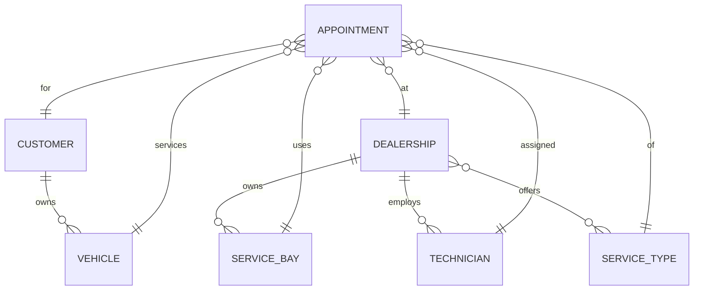
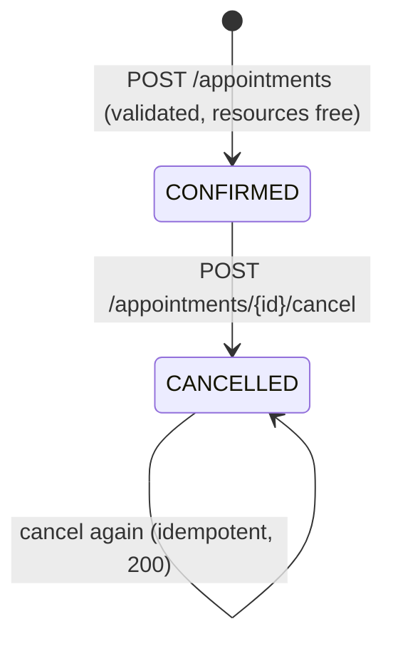

# Data Model: Unified Service Scheduler

**Feature**: [spec.md](./spec.md) | **Plan**: [plan.md](./plan.md) | **Date**: 2026-11-02

The same shapes are used by the OpenAPI contract ([contracts/openapi.yaml](./contracts/openapi.yaml)),
the mock store and the pure domain functions. Conventions:

- `id` fields are opaque strings (UUID v4 for generated records, readable slugs in seed data).
- Instants (`start`, `end`, `createdAt`, `cancelledAt`) are ISO-8601 **UTC** strings.
- Local wall-clock values (`openingHours.open/close`) are `HH:mm` in the dealership's `timeZone`.
- `[start, end)` is half-open: a window ending at 11:00 does not conflict with one starting at
  11:00 (FR-006).

## Entity diagram



## Entities

### Dealership

| Field | Type | Rules |
|---|---|---|
| id | string | required, unique |
| name | string | required, 1–100 chars |
| timeZone | string | required, valid IANA zone (e.g. `Europe/London`) |
| openingHours | `{ open: "HH:mm", close: "HH:mm" }` | `open < close`; same every open day |
| openDays | int[] | ISO weekdays 1–7, non-empty (default Mon–Sat `[1..6]`) |
| serviceTypeIds | string[] | service types offered here (FR-002) |

### ServiceType

| Field | Type | Rules |
|---|---|---|
| id | string | required, unique |
| name | string | e.g. "Oil change", "EV battery check" |
| durationMinutes | int | > 0, multiple of 15 |
| requiredSkill | enum `Skill` | technician must hold it |
| requiredBayType | enum `BayType` | bay must be this type |

`Skill` = `GENERAL_MAINTENANCE | BRAKES | EV_SYSTEMS | DIAGNOSTICS | ALIGNMENT`
`BayType` = `GENERAL | EV | ALIGNMENT`

### ServiceBay

| Field | Type | Rules |
|---|---|---|
| id | string | required, unique |
| dealershipId | string | FK → Dealership |
| name | string | unique within dealership (e.g. "Bay 3") |
| type | `BayType` | |
| active | boolean | inactive bays are never assigned |

### Technician

| Field | Type | Rules |
|---|---|---|
| id | string | required, unique |
| dealershipId | string | FK → Dealership |
| name | string | used for tie-break ordering (FR-010) |
| skills | `Skill[]` | non-empty |
| workingDays | int[] | ISO weekdays; subset of dealership `openDays` |

Working hours equal dealership opening hours (spec assumption).

### Customer

| Field | Type | Rules |
|---|---|---|
| id | string | required |
| firstName, lastName | string | required |
| phone | string | E.164 |
| email | string | valid email |
| vehicles | Vehicle[] | embedded in API responses for search (FR-001) |

Search (`q`) matches case-insensitively on full name, phone digits or email; min 2 chars.

### Vehicle

| Field | Type | Rules |
|---|---|---|
| id | string | required |
| customerId | string | FK → Customer |
| vin | string | 17 chars, `[A-HJ-NPR-Z0-9]` |
| make, model | string | required |
| year | int | 1980 – current year + 1 |

### Appointment

| Field | Type | Rules |
|---|---|---|
| id | string | UUID |
| reference | string | human-friendly unique, format `APT-YYYYMMDD-XXXX` (FR-012) |
| status | `CONFIRMED \| CANCELLED` | see state machine |
| customerId, vehicleId | string | vehicle must belong to customer |
| dealershipId, serviceTypeId | string | service type must be offered by dealership |
| technicianId, bayId | string | must belong to dealership |
| start, end | ISO UTC | `end = start + serviceType.durationMinutes` (FR-004) |
| createdAt | ISO UTC | set by server |
| cancelledAt | ISO UTC \| null | set on cancel |

API responses return an `AppointmentView` = Appointment + denormalised display fields
(`customerName`, `vehicleLabel`, `serviceTypeName`, `technicianName`, `bayName`) so the schedule
list needs one request.

### IdempotencyRecord (mock store internal, not exposed)

| Field | Type | Rules |
|---|---|---|
| key | string | `Idempotency-Key` header, UUID |
| requestHash | string | stable hash of the request body |
| appointmentId | string | appointment created by the first request |
| createdAt | ISO UTC | records older than 24 h may be pruned |

## Value objects used by the domain

```text
TimeWindow          { start: Instant, end: Instant }                 // half-open
AvailabilityRequest { dealershipId, serviceTypeId, start }
Assignment          { technicianId, bayId }
UnavailableReason   = START_IN_PAST | OUTSIDE_OPENING_HOURS | DEALERSHIP_CLOSED
                    | NO_QUALIFIED_TECHNICIAN | NO_COMPATIBLE_BAY
                    | SERVICE_NOT_OFFERED
                    | PROPOSED_RESOURCE_TAKEN   // 409 on confirm only (research R8)
AvailabilityResult  { available: true,  window, assignment }
                  | { available: false, window, reason, alternatives: Instant[] }
```

Reason precedence (first that applies is reported): `SERVICE_NOT_OFFERED` →
`START_IN_PAST` → `DEALERSHIP_CLOSED` → `OUTSIDE_OPENING_HOURS` → `NO_QUALIFIED_TECHNICIAN` →
`NO_COMPATIBLE_BAY`.

## Validation rules (traceability)

| Rule | Source |
|---|---|
| `start` aligned to 15-minute boundary in dealership local time | FR-003 |
| `end = start + duration` | FR-004 |
| technician has `requiredSkill`, works that weekday, no overlapping CONFIRMED appointment | FR-005, FR-006, edge cases |
| bay is `active`, type = `requiredBayType`, no overlapping CONFIRMED appointment | FR-005, FR-006, edge cases |
| window inside opening hours on an open day | FR-007, edge cases |
| `start > now` | FR-007, edge cases |
| vehicle belongs to customer; service offered at dealership; resources belong to dealership | integrity |
| CANCELLED appointments ignored in all overlap checks | FR-016 |

## State machine: Appointment



No other transitions (rescheduling = cancel + new booking, per spec assumption).

## Seed data (synthetic)

- 2 dealerships: "Keyloop Motors London" (`Europe/London`, 08:00–18:00, Mon–Sat) and
  "Keyloop Motors Saigon" (`Asia/Ho_Chi_Minh`, 07:30–17:30, Mon–Sat).
- 5 service types: Oil change (60 min, GENERAL_MAINTENANCE, GENERAL), Brake service (90, BRAKES,
  GENERAL), EV battery check (120, EV_SYSTEMS, EV), Wheel alignment (45, ALIGNMENT, ALIGNMENT),
  Diagnostics (30, DIAGNOSTICS, GENERAL).
- Per dealership: 4 bays (2 GENERAL, 1 EV, 1 ALIGNMENT incl. one inactive GENERAL in London),
  4 technicians with overlapping skill sets; exactly **one** EV technician per dealership so the
  "no qualified technician" path is easy to demo.
- 10 customers with 1–2 vehicles each.
- Appointments generated relative to "today" at seed time so demos always have data
  (including one CANCELLED).
