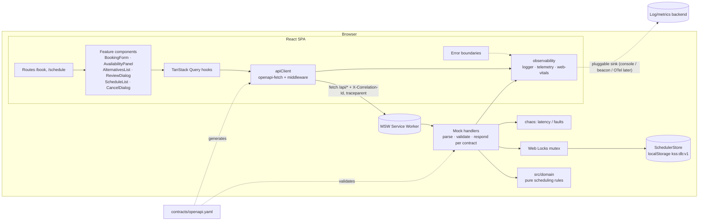

# Implementation Plan: Unified Service Scheduler

**Branch**: `001-service-scheduler` | **Date**: 2026-11-02 | **Spec**: [spec.md](./spec.md)

**Input**: Feature specification from `/specs/001-service-scheduler/spec.md`

**Note**: This template is filled in by the `/speckit-plan` command; its definition describes the execution workflow.

## Summary

Build the **frontend** of a dealership service appointment scheduler (Keyloop assessment,
Scenario A). Advisors search a customer and vehicle, pick dealership, service type and start
time; the app checks in real time that a compatible bay and a qualified technician are both free
for the whole service window, proposes the resources, and confirms a persistent appointment.
Unavailable requests get a reason and the 5 nearest alternative slots; concurrent confirms are
safe and idempotent; advisors can view and cancel a day's appointments.

Technical approach: a React 19 + TypeScript SPA (Vite) whose only boundary to the backend is an
OpenAPI 3.1 contract. The backend is mocked at the network layer with MSW; mock handlers delegate
every scheduling decision to a pure, framework-free `src/domain` module (unit-tested first,
≥ 90% coverage) and persist to a versioned localStorage repository. Cross-tab double-booking is
prevented with a Web Locks mutex plus `Idempotency-Key` replay. Observability is built in via a
typed API client middleware (correlation id / `traceparent`, structured logs, durations), a
business-event telemetry module, Web Vitals and error boundaries. See [research.md](./research.md).

## Technical Context

**Language/Version**: TypeScript 5.x (`strict`), targeting ES2022; Node.js 22 LTS for tooling

**Primary Dependencies**: React 19, Vite 6, React Router 7, TanStack Query 5, openapi-fetch +
openapi-typescript, MSW 2, React Hook Form + Zod, date-fns 4 + @date-fns/tz, Tailwind CSS 4 +
shadcn/ui (Radix primitives), react-error-boundary, web-vitals (justifications: research R1–R14)

**Storage**: Browser localStorage via a `SchedulerStore` repository (`kss:db:v1`, versioned,
seeded, resettable); in-memory implementation for tests (research R6)

**Testing**: Vitest (unit, contract, component with React Testing Library + user-event + MSW
node), Playwright (e2e, multi-page conflict), vitest-axe + @axe-core/playwright (a11y)

**Target Platform**: Evergreen desktop browsers (Chrome, Edge, Firefox, Safari — last 2
versions), usable down to 1024 px wide; tablet-friendly; deployed as a static site

**Project Type**: Web application — frontend SPA with network-level mocked backend

**Performance Goals**: Availability result rendered < 1 s p95 including simulated latency
(SC-002); domain availability + alternatives computation < 20 ms; LCP < 2.5 s, INP < 200 ms;
initial JS < 250 kB gzip

**Constraints**: No real backend; all API shapes generated from contract; no `Date.now()` in
domain; WCAG 2.1 AA; times displayed in dealership time zone; no double-booking across tabs;
synthetic data only

**Scale/Scope**: 2 dealerships, ~8 bays, ~8 technicians, 5 service types, 10 customers, a few
hundred appointments; 2 routes (`/book`, `/schedule`), ~15 components, 8 API operations

## Constitution Check

*GATE: Must pass before Phase 0 research. Re-check after Phase 1 design.*

| # | Principle | How the plan complies | Status |
|---|---|---|---|
| I | Contract-First API Boundary | `contracts/openapi.yaml` (OpenAPI 3.1, linted with Redocly) is the source of truth; `src/api/schema.gen.ts` generated by openapi-typescript; `contract:check` CI step fails on drift; handlers validated against schema in contract tests | ✅ |
| II | Pure, Framework-Free Domain Logic | `src/domain/` holds overlap, opening hours, qualification, assignment, alternatives, validation; no React/fetch/storage imports (enforced by ESLint `no-restricted-imports` on that folder); `now` passed as parameter | ✅ |
| III | Test-First for Business Rules | tasks.md will order domain tests before implementation; boundary cases listed in data-model validation table; Vitest coverage threshold 90% on `src/domain/**`; e2e for happy + conflict path | ✅ |
| IV | Realistic Mock Backend | MSW intercepts at network layer in browser and tests; localStorage persistence + reset/seed; chaos module simulates latency and 500s; 400/404/409/422 from real handler logic; handlers call `src/domain` only | ✅ |
| V | No Double-Booking | Half-open overlap rule; re-validation inside Web Locks critical section; 409 on stale proposal (no silent reassignment); required `Idempotency-Key` with replay | ✅ |
| VI | Observable by Default | Single `apiClient` with middleware (correlation id, `traceparent`, structured log, duration); route error boundaries; `telemetry.track` business events; web-vitals; swappable sinks | ✅ |
| VII | Accessible, Simple UI | Radix-based primitives, live regions for results, keyboard e2e, axe in CI; every dependency justified in research.md; only 2 routes, no global store | ✅ |
| — | Tech constraints (strict TS, UTC ISO, CI gates, synthetic data) | `strict: true`, `@typescript-eslint/no-explicit-any` error except `*.gen.ts`; ISO UTC in contract; GitHub Actions pipeline; generated seed | ✅ |
| — | Workflow & AI collaboration | Spec → plan → tasks → analyze → implement; per-phase commits referencing task IDs; `docs/ai-collaboration-log.md` started during planning | ✅ |

**Gate result (pre-research)**: PASS — no violations.

**Gate result (post-design re-check)**: PASS. Design artifacts introduced no new projects, no
global state store and no repository pattern beyond the single `SchedulerStore` seam that
Principle IV requires (reset/seed + swappable persistence). One design defect was caught and
fixed during Phase 1: a boolean `discriminator` in the contract made generated types
`available: "true"` (string); removed so types narrow on `available: true | false`.

## Architecture



**Replace-the-mock path**: a real backend implementing `contracts/openapi.yaml` is enabled by
setting `VITE_ENABLE_MOCKS=false` and `VITE_API_BASE_URL`; `src/domain` can be lifted into that
service unchanged.

### Key data flows

1. **Check availability** — form complete & valid → debounced (300 ms) query
   `POST /availability/check` → handler loads dealership, service type, resources and
   overlapping CONFIRMED appointments → `checkAvailability(req, data, now)` → `Available` with
   assignment, or `Unavailable` with reason + `findAlternatives(...)` → panel rendered in a live
   region; `availability.checked` event logged.
2. **Confirm** — review dialog opens → client creates `Idempotency-Key` → `POST /appointments`
   with reviewed technician/bay → handler acquires `kss-booking` lock → idempotency lookup
   (replay if seen) → re-read store → verify proposed resources still free → write appointment +
   idempotency record → 201. Otherwise 409 `ConflictProblem` with fresh alternatives → UI keeps
   form state, shows alternatives; `booking.conflict` logged. On success the
   `appointments(dealershipId, date)` query is invalidated.
3. **Cancel** — `POST /appointments/{id}/cancel` → status `CANCELLED`, `cancelledAt` set
   (idempotent) → list invalidated → freed slot becomes bookable.

## Project Structure

### Documentation (this feature)

```text
specs/001-service-scheduler/
├── spec.md              # Feature specification (/speckit-specify)
├── plan.md              # This file (/speckit-plan)
├── research.md          # Phase 0 decisions R1–R17
├── data-model.md        # Entities, validation rules, state machine, seed
├── quickstart.md        # Run + validation scenarios V1–V10
├── contracts/
│   └── openapi.yaml     # OpenAPI 3.1 contract (8 operations)
├── checklists/
│   └── requirements.md  # Spec quality checklist
└── tasks.md             # Phase 2 output (/speckit-tasks — NOT created here)
```

### Source Code (repository root)

```text
contracts/
└── openapi.yaml                 # Copied from specs/…/contracts; the runtime source of truth

src/
├── main.tsx                     # Boots MSW (if enabled) then renders <App/>
├── app/
│   ├── App.tsx                  # Providers: QueryClient, Router, ErrorBoundary, Toaster
│   ├── routes.tsx               # /book, /schedule, redirect / → /book
│   └── Layout.tsx               # Nav, skip link, dev panel slot
├── domain/                      # PURE — no React/fetch/storage/Date.now (Principle II)
│   ├── types.ts                 # Domain types (aliases of generated API types where shared)
│   ├── time.ts                  # overlaps, addMinutes, zoned day/opening-hours helpers
│   ├── rules.ts                 # isQualified, isBayCompatible, isWithinOpeningHours, isOpenDay
│   ├── assignment.ts            # pickTechnician / pickBay (least-booked, tie by name)
│   ├── availability.ts          # checkAvailability(req, snapshot, now)
│   ├── alternatives.ts          # findAlternatives(req, snapshot, now, {limit:5, horizonDays:7})
│   ├── booking.ts               # validateBooking, buildAppointment, reference generator
│   └── *.test.ts                # Colocated unit tests (written first)
├── api/
│   ├── schema.gen.ts            # GENERATED from contracts/openapi.yaml — do not edit
│   ├── client.ts                # openapi-fetch instance + middleware (correlation, logging, problem+json)
│   ├── queries.ts               # TanStack Query hooks & keys
│   └── errors.ts                # ApiError / ConflictError mapping from Problem
├── mocks/
│   ├── browser.ts / node.ts     # setupWorker / setupServer with shared handlers
│   ├── handlers/                # one file per tag: reference, customers, availability, appointments
│   ├── store/
│   │   ├── SchedulerStore.ts    # Interface
│   │   ├── localStorageStore.ts
│   │   └── memoryStore.ts
│   ├── seed.ts                  # Deterministic synthetic seed relative to a given "today"
│   ├── lock.ts                  # Web Locks with in-process fallback
│   ├── idempotency.ts
│   └── chaos.ts                 # Latency / failure injection settings
├── features/
│   ├── booking/                 # BookingPage, BookingForm, CustomerCombobox, AvailabilityPanel,
│   │                            # AlternativesList, ReviewDialog, BookingSuccess, useBookingFlow
│   └── schedule/                # SchedulePage, ScheduleFilters, AppointmentList, CancelDialog
├── components/ui/               # shadcn/ui copies (button, select, dialog, alert-dialog, toast…)
├── observability/
│   ├── logger.ts                # Structured events + sinks
│   ├── telemetry.ts             # track(), metrics helpers
│   ├── correlation.ts           # id + W3C traceparent generation
│   ├── webVitals.ts
│   └── RouteErrorBoundary.tsx
├── devtools/
│   └── MockDevPanel.tsx         # Reset data, latency, failure rate (dev/demo only)
└── lib/
    └── format.ts                # Dealership-zone date/time formatting for UI

tests/
├── contract/                    # Handler responses validated against OpenAPI (Ajv)
├── e2e/                         # Playwright: booking, conflict (2 pages), a11y, keyboard
└── setup/                       # Vitest setup: MSW server, MemoryStore, fake timers helpers

docs/
├── system-design.md             # Assessment deliverable 1 (diagram, components, flow, tech, observability, GenAI)
└── ai-collaboration-log.md      # Running log of AI prompts, catches, overrides (Constitution)

.github/workflows/ci.yml         # lint → typecheck → contract:check → test:coverage → build → e2e
```

**Structure Decision**: Single web-application project at the repository root (frontend only;
no `backend/` folder because the backend is mocked). Separation that matters for the assessment
is by folder boundary: `src/domain` (pure, portable business rules) ← `src/mocks` (backend
simulation) ← `src/api` (contract-typed client) ← `src/features` (UI). Imports flow only in that
direction; ESLint `import/no-restricted-paths` enforces it (e.g. `features` may not import
`mocks`, `domain` may import nothing app-specific).

## Observability Strategy (summary — details in research R14)

| Signal | What | Where |
|---|---|---|
| Logs | `{ts, level, event, traceId, correlationId, operation, status, durationMs}` JSON | `observability/logger.ts`, emitted by API middleware & handlers |
| Traces | W3C `traceparent` + `X-Correlation-Id` per request, echoed by mock, shown in error UI | `observability/correlation.ts`, `api/client.ts` |
| Metrics | API latency histogram (from logs), availability-check count, conflict rate, Web Vitals | `observability/telemetry.ts`, `webVitals.ts` |
| Errors | Route error boundaries + global `unhandledrejection` handler | `RouteErrorBoundary.tsx`, `main.tsx` |
| Business events | `availability.checked`, `booking.confirmed`, `booking.conflict`, `booking.cancelled` | feature hooks |

## Risks & Mitigations

| Risk | Mitigation |
|---|---|
| DST / time-zone bugs | All domain math in UTC instants with tz conversion only at day/opening-hour boundaries; unit tests on DST-change dates for `Europe/London` |
| MSW service worker not active on first load | `main.tsx` awaits `worker.start()` before render; Playwright waits for ready flag |
| AI-generated domain code subtly wrong (overlap edges) | Human-written boundary test table first (Principle III); review checklist in AI log |
| localStorage cleared / schema change | Versioned key, auto re-seed, Reset button |
| Contract drift between handlers and types | Generated types + Ajv response validation in contract tests + CI `contract:check` |

## Complexity Tracking

> No Constitution violations — table intentionally empty.

| Violation | Why Needed | Simpler Alternative Rejected Because |
|-----------|------------|-------------------------------------|
| — | — | — |
